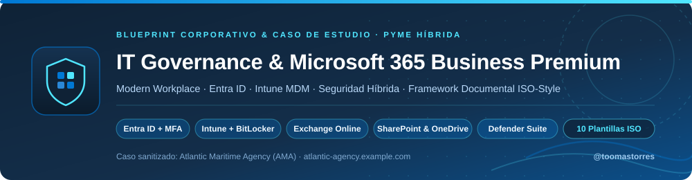
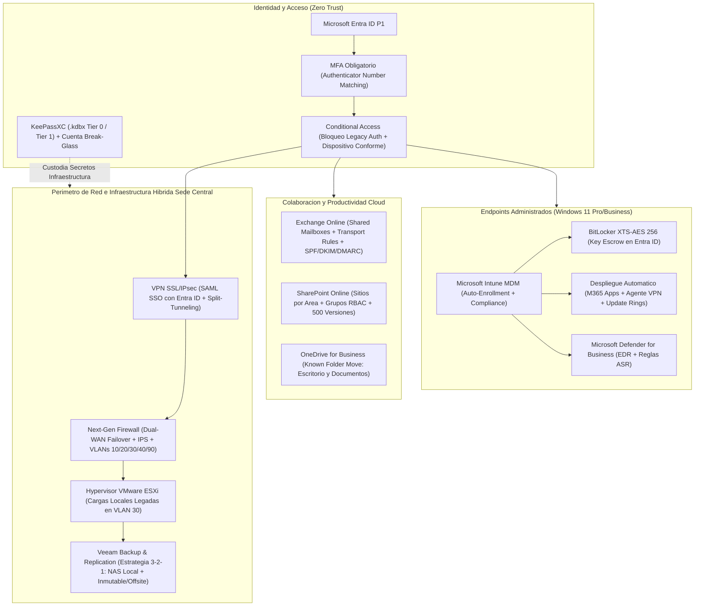

<p align="center">
  
</p>

# 🛡️ Gobierno IT & Modern Workplace con Microsoft 365 Business Premium

> **Caso de estudio de transformación operativa + Blueprint reutilizable de Gobierno IT** para PyMEs (15–100 usuarios): migración y administración de **Microsoft 365 Business Premium** (*Entra ID, Intune MDM, Exchange Online, SharePoint, OneDrive y Defender*), arquitectura híbrida perimetral (*Firewall, VPN, ESXi y Backups 3-2-1*) y **sistema documental codificado estilo ISO (`00` a `99`)** listo para clonar.


[](LICENSE)

> ℹ️ **Caso de estudio sanitizado + Kit de plantillas reutilizables.** Basado en trabajo real de administración y estructuración de IT corporativa, pero la organización (**Atlantic Maritime Agency / AMA** — `atlantic-agency.example.com`, ~25–30 usuarios), los proveedores, los nombres de activos y **todas las direcciones IP (RFC 5737 / RFC 1918) son estrictamente ilustrativos/ficticios**. No incluye credenciales, inventarios reales ni información confidencial.

---

## 1. El Desafío: De Oficina Tradicional sin Gobierno a Modern Workplace

**Atlantic Maritime Agency (AMA)** (~28 colaboradores entre finanzas, operaciones portuarias, comercial y dirección) operaba sobre un esquema IT típico de PyME tradicional que había crecido de manera orgánica sin estandarización documental ni controles centralizados en la nube.

El objetivo del proyecto fue **eliminar los puntos únicos de falla (técnicos y humanos)** consolidando identidad, correo, colaboración y seguridad de endpoints sobre **Microsoft 365 Business Premium**, ordenando la infraestructura híbrida remanente y construyendo desde cero el **marco normativo y documental del área de IT**.

| Dimensión | Estado Inicial (Oficina Tradicional) | Estado Objetivo (Modern Workplace Gobernado) |
|---|---|---|
| **Identidad y Accesos** | Contraseñas sin MFA uniforme, casillas genéricas compartidas con una misma clave y cuentas con permisos excesivos. | **Microsoft Entra ID** con **100% MFA** (*Number Matching*), Acceso Condicional (`CA-001..005`), cuentas `adm-*` separadas y cuenta *Break-Glass* auditada. |
| **Correo Corporativo** | Casillas dispersas, archivos `.pst` locales en riesgo de pérdida y ausencia de políticas estrictas anti-spoofing. | **Exchange Online** con buzones de 50 GB + archivo en línea, **buzones compartidos por área** auditables, reglas anti-phishing y **`SPF` + `DKIM` + `DMARC (p=reject)`**. |
| **Archivos y Respaldo de Puestos** | Carpetas compartidas SMB locales sin versionado en nube, dependientes de VPN permanente, y documentos sueltos en discos locales. | **SharePoint Online** segmentado por sitio/rol (`RBAC` por grupos `SG-SPO-*`) + **OneDrive Known Folder Move (KFM)** respaldando `Escritorio` y `Documentos` en tiempo real. |
| **Gestión de Equipos (Endpoints)** | Notebooks sin inventario vivo, usuarios con permisos de administrador local y discos sin cifrado gestionado. | **Microsoft Intune MDM**: cumplimiento obligatorio, despliegue automático de **M365 Apps/VPN**, remoción de admin local y **BitLocker silencioso con custodia automática de claves en Entra ID**. |
| **Seguridad y Credenciales IT** | Antivirus dispar, sin EDR centralizado y secretos técnicos dispersos en archivos o conocimiento informal. | **Microsoft Defender for Business** (EDR + reglas ASR + Safe Links/Attachments) + bóvedas **`KeePassXC` (`.kdbx`)** segmentadas (`Tier 0` / `Tier 1`). |
| **Conocimiento y Continuidad IT** | Conocimiento "tribal" no documentado (*Single Point of Failure* humano ante ausencias o incidentes). | **Repositorio Documental de IT (`Capítulos 00 a 99`)** con taxonomía codificada (`IT-NOR`, `IT-POL`, `IT-FT`, `IT-INS`, `IT-PRO`). |

---

## 2. Arquitectura Integrada (Cloud + Perímetro Híbrido)



> 📖 **Profundización técnica:** El detalle completo de políticas de Acceso Condicional, registros DNS `SPF/DKIM/DMARC`, perfiles de cifrado Intune, diseño de SharePoint y scripts PowerShell de verificación se encuentra en el **[Playbook de Implementación de Microsoft 365 Business Premium (`docs/m365-business-premium-rollout.md`)](docs/m365-business-premium-rollout.md)**.

---

## 3. Arquitectura del Repositorio Documental de IT (`00` a `99`)

Uno de los pilares centrales del proyecto fue diseñar un **sistema de gestión documental de IT inspirado en normas ISO/IEC 27001 e ITIL**, liviano de mantener para un equipo reducido pero riguroso frente a auditorías, onboarding de personal o respuesta ante incidentes.

### 3.1 Estructura de Capítulos Oficiales

```text
Repositorio-Gobierno-IT/
├── 00 - Índice y Normas/              # Marco documental (IT-NOR) y políticas obligatorias (IT-POL)
├── 01 - Inventario/                   # Parque de notebooks/PCs, números de serie, red y licencias CSP
├── 02 - Credenciales y Accesos/       # Bóvedas cifradas KeePassXC (.kdbx) Tier 0/1 y matriz RBAC
├── 03 - Red, Firewall y VPN/          # Topología WAN/VLAN, reglas perimetrales y túneles VPN (IT-FT)
├── 04 - Microsoft 365/                # Fichas As-Built de Entra ID, Exchange, Intune y SharePoint (IT-FT)
├── 05 - Servidores y Backups/         # Hipervisor ESXi, VMs locales, estrategia Veeam 3-2-1 y pruebas DRP
├── 06 - Instructivos y Procedimientos/# Guías de usuario (IT-INS) y runbooks técnicos de soporte (IT-PRO)
├── 07 - Proveedores y Contratos/      # Contratos ISP, partner CSP, hardware, SLAs y escalamiento 24x7
├── 08 - Proyectos y Migraciones/      # Business cases, planes de corte (cutover) y minutas de proyecto
├── 09 - Instaladores/                 # Binarios corporativos homologados y verificados por hash SHA-256
└── 99 - Archivo/                      # Histórico trazable de configuraciones o sistemas reemplazados
```

### 3.2 Taxonomía Codificada de Documentos

| Prefijo | Categoría | Propósito | Audiencia |
|---|---|---|---|
| **`IT-NOR`** | **Norma Técnica** | Define reglas internas de estructura, nomenclatura de activos y control de versiones de IT. | Equipo IT / Auditores |
| **`IT-POL`** | **Política Corporativa** | Fija lineamientos obligatorios de seguridad, credenciales, MFA y ciclo de altas/bajas (*JML*). | Toda la empresa |
| **`IT-FT`** | **Ficha Técnica (*As-Built*)** | Registra la configuración exacta vigente de cada plataforma para operación y contingencia. | SysAdmins / Consultores |
| **`IT-INS`** | **Instructivo de Usuario** | Explica tareas frecuentes en lenguaje claro para reducir tickets repetitivos de mesa de ayuda. | Usuarios finales |
| **`IT-PRO`** | **Procedimiento Operativo** | Detalla secuencias paso a paso críticas y auditables (ej. recuperación y rotación de BitLocker). | Soporte IT / Admins |

---

## 4. Contenido de Este Repositorio (Kit de 10 Plantillas + Playbook)

| Archivo / Plantilla | Tipo | Qué Incluye |
|---|---|---|
| [`docs/m365-business-premium-rollout.md`](docs/m365-business-premium-rollout.md) | **Playbook Técnico** | Guía integral de arquitectura: Entra ID, Exchange, Intune, BitLocker, SharePoint, Defender, hoja de ruta de 6 semanas y scripts PowerShell. |
| [`templates/00-indice-y-normas/IT-NOR-000-organizacion-documental-it.md`](templates/00-indice-y-normas/IT-NOR-000-organizacion-documental-it.md) | `IT-NOR-000` | Norma madre: capítulos `00`–`99`, taxonomía de prefijos, nomenclatura de hostnames/grupos y control de versiones. |
| [`templates/00-indice-y-normas/IT-POL-001-politica-credenciales-mfa-y-accesos.md`](templates/00-indice-y-normas/IT-POL-001-politica-credenciales-mfa-y-accesos.md) | `IT-POL-001` | Política NIST de contraseñas, MFA obligatorio, bóvedas `KeePassXC` y protocolo de altas/cambios/bajas en < 15 min. |
| [`templates/01-inventario/guia-inventario-equipos-y-licencias.md`](templates/01-inventario/guia-inventario-equipos-y-licencias.md) | `Guía Cap. 01` | Esquema de planilla maestra de estaciones, infraestructura de red, licencias M365 y rutina mensual de conciliación. |
| [`templates/03-red-firewall-vpn/IT-FT-001-arquitectura-red-firewall-y-vpn.md`](templates/03-red-firewall-vpn/IT-FT-001-arquitectura-red-firewall-y-vpn.md) | `IT-FT-001` | Topología Dual-WAN failover, segmentación en 5 VLANs, Wi-Fi corporativo vs. invitados y VPN SSL con SAML MFA. |
| [`templates/04-microsoft-365/IT-FT-002-microsoft-365-y-exchange-online.md`](templates/04-microsoft-365/IT-FT-002-microsoft-365-y-exchange-online.md) | `IT-FT-002` | Configuración del tenant, registros DNS (`MX`, `SPF`, `DKIM`, `DMARC`), buzones compartidos y reglas de transporte. |
| [`templates/04-microsoft-365/IT-FT-003-identidad-entra-id-y-equipos-intune.md`](templates/04-microsoft-365/IT-FT-003-identidad-entra-id-y-equipos-intune.md) | `IT-FT-003` | Políticas de Acceso Condicional, cumplimiento Windows en Intune, BitLocker silencioso y despliegue de apps. |
| [`templates/04-microsoft-365/IT-FT-004-sharepoint-y-carpetas-compartidas.md`](templates/04-microsoft-365/IT-FT-004-sharepoint-y-carpetas-compartidas.md) | `IT-FT-004` | Mapa de sitios SharePoint por área, matriz RBAC, sincronización OneDrive KFM y restauración ante ransomware. |
| [`templates/06-instructivos-y-procedimientos/IT-INS-001-instalacion-y-conexion-vpn.md`](templates/06-instructivos-y-procedimientos/IT-INS-001-instalacion-y-conexion-vpn.md) | `IT-INS-001` | Guía clara para usuarios remotos: cuándo usar VPN, ingreso SSO con MFA y resolución de errores frecuentes. |
| [`templates/06-instructivos-y-procedimientos/IT-INS-004-primer-ingreso-m365-y-mfa.md`](templates/06-instructivos-y-procedimientos/IT-INS-004-primer-ingreso-m365-y-mfa.md) | `IT-INS-004` | Instructivo de onboarding: cambio de clave inicial, escaneo QR en Microsoft Authenticator y validación de OneDrive. |
| [`templates/06-instructivos-y-procedimientos/IT-PRO-001-recuperacion-clave-bitlocker-intune.md`](templates/06-instructivos-y-procedimientos/IT-PRO-001-recuperacion-clave-bitlocker-intune.md) | `IT-PRO-001` | Runbook técnico de soporte: validación de identidad, lectura de `Key ID` en Intune, re-sellado TPM y rotación post-uso. |

---

## 5. Cómo Reutilizar Este Blueprint en una PyME en Días (en Lugar de Meses)

Cualquier **Responsable de IT, SysAdmin, Analista de Infraestructura o Gerente de Operaciones** que reciba una oficina desordenada puede adoptar este repositorio en 5 pasos concretos:

1. **Clonar la estructura base:**
   ```bash
   git clone https://github.com/toomastorres/it-governance-m365-blueprint.git
   ```
2. **Crear el sitio privado de Gobierno IT en SharePoint (`/sites/tuempresa-it`):** Replicar allí las carpetas numeradas `00 - Índice y Normas` a `09 - Instaladores` y `99 - Archivo` definidas en [`IT-NOR-000`](templates/00-indice-y-normas/IT-NOR-000-organizacion-documental-it.md), restringiendo el acceso exclusivamente a IT y Dirección.
3. **Adaptar variables de organización (Buscar y Reemplazar en `templates/`):** Sustituir `Atlantic Maritime Agency (AMA)`, `atlantic-agency.example.com`, los rangos VLAN `10.20.x.0/24` y la sigla `AMA-NB-XXX` por los identificadores reales de tu empresa.
4. **Inicializar las bóvedas cifradas en el Capítulo `02`:** Crear las bases `KeePassXC` (`.kdbx`) separadas para `Tier 0` y `Tier 1`, migrar todas las contraseñas heredadas fuera de planillas Excel y aplicar la política [`IT-POL-001`](templates/00-indice-y-normas/IT-POL-001-politica-credenciales-mfa-y-accesos.md).
5. **Ejecutar el despliegue técnico en 5 fases:** Seguir la secuencia de las semanas 1 a 6 del **[Playbook `m365-business-premium-rollout.md`](docs/m365-business-premium-rollout.md)** (Identidad y MFA → Exchange y DMARC → SharePoint y OneDrive KFM → Intune, BitLocker y Defender), distribuyendo a los usuarios los instructivos listos `IT-INS-004` e `IT-INS-001`.

---

## 6. Mi Rol y Competencias Demostradas

Este proyecto complementa el **[Caso de Estudio de Modernización de ERP e Infraestructura Cloud (`erp-modernization-case-study`)](https://github.com/toomastorres/erp-modernization-case-study)** mostrando la ejecución práctica en gobierno tecnológico y operación del puesto de trabajo moderno:

- **Administración Cloud Microsoft 365 Business Premium:** Gobierno integral de identidades en **Entra ID**, correo corporativo y autenticación DNS en **Exchange Online**, administración moderna de dispositivos y cifrado en **Intune**, arquitectura documental **SharePoint/OneDrive** y seguridad en **Microsoft Defender**.
- **Infraestructura Híbrida y Continuidad Operativa:** Coordinación y documentación de red segmentada, firewall perimetral con doble WAN, VPN con MFA, virtualización local (**VMware ESXi**) y estrategia de respaldo **Veeam 3-2-1**.
- **Gobierno IT y Estandarización de Procesos:** Diseño de taxonomías documentales auditables, políticas de control de accesos (*JML*), gestión segura de credenciales (`KeePassXC`) y creación de guías orientadas a la adopción real del usuario final.

---

## 📄 Licencia y Autoría

Distribuido bajo licencia **[MIT](LICENSE)** — libre para tomar como base, adaptar e implementar en tu organización.

**Autor:** **Tomás Torres** (`@toomastorres`)  
📍 CABA, Argentina · 💼 [LinkedIn](https://www.linkedin.com/in/tomastorres2004/) · 📫 torrestomas.2004@gmail.com
