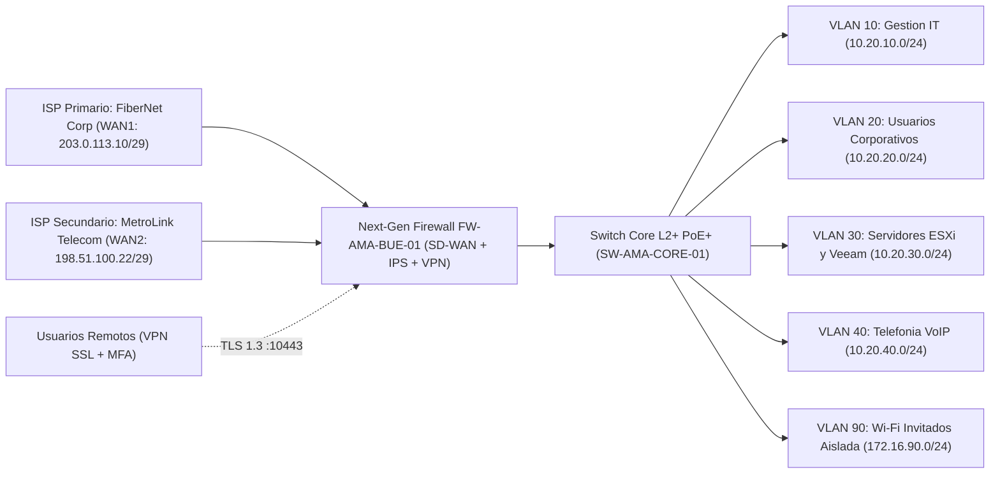

# IT-FT-001 — Ficha Técnica: Arquitectura de Red, Firewall Perimetral y VPN

| Campo | Detalle |
|---|---|
| **Código Documental** | `IT-FT-001` |
| **Versión** | `1.0` |
| **Fecha de Vigencia** | `2026-03-01` |
| **Capítulo** | `03 - Red, Firewall y VPN` |
| **Clasificación** | Confidencial Interno — Exclusivo IT |
| **Organización (Ejemplo)** | Atlantic Maritime Agency (AMA) — Sede Central CABA |
| **Responsable / Autor** | Tomás Torres — Digital Transformation & IT Governance Lead |

> **Aviso de sanitización:** Todas las direcciones IP públicas pertenecen a los bloques reservados para documentación **RFC 5737** (`203.0.113.0/24` y `198.51.100.0/24`) y los proveedores mencionados son ficticios. Ningún secreto o clave reside en este archivo; consultar `KeePassXC > AMA-Tier0-Infraestructura.kdbx`.

---

## 1. Resumen de Topología de Red

La sede central opera bajo un esquema de **doble enlace WAN con conmutación automática (*SD-WAN / Dual-WAN Failover*)** terminado en un **Next-Generation Firewall (`FW-AMA-BUE-01`)**, segmentación lógica en **VLANs 802.1Q** sobre switching gestionable y acceso remoto cifrado mediante **VPN SSL/IPsec** autenticado con MFA.

---

## 2. Enlaces a Internet (WAN) y Alta Disponibilidad

| Interfaz Firewall | Rol | Proveedor (Ficticio) | Tecnología / Ancho de Banda | IP Pública Fija (RFC 5737) | Gateway ISP | Monitoreo de Salud (*Health Check*) |
|---|---|---|---|---|---|---|
| `WAN1 (port1)` | Primario Activo | `FiberNet Corp` | Fibra Dedicada Simétrica `300 Mbps` | `203.0.113.10/29` | `203.0.113.9` | Ping ICMP/DNS hacia `1.1.1.1` y `8.8.8.8` (umbral 5 pérdida paq.) |
| `WAN2 (port2)` | Backup / Failover Automático | `MetroLink Telecom` | Fibra Corporativa `200 Mbps` | `198.51.100.22/29` | `198.51.100.17` | Ping continuo; toma el tráfico en `< 5 segundos` ante caída de `WAN1` |

- **Registro DNS Público para VPN (`DDNS / Dual A-Record`):** `vpn.atlantic-agency.example.com` apunta a `203.0.113.10` (con entrada de contingencia `vpn-bkp.atlantic-agency.example.com` hacia `198.51.100.22`).

---

## 3. Plan de Direccionamiento Interno y Segmentación VLAN

| VLAN ID | Nombre del Segmento | Subred CIDR | Gateway (`FW`) | Rango DHCP | Acceso Inter-VLAN | Propósito |
|---|---|---|---|---|---|---|
| `10` | `MGMT_IT` | `10.20.10.0/24` | `10.20.10.1` | Estático (`.2–.50`) | Solo desde puesto Admin IT / Salto autorizado | Interfaces de gestión de Firewall, Switches, APs, iDRAC/iLO y UPS. |
| `20` | `CORP_LAN_WIFI` | `10.20.20.0/24` | `10.20.20.1` | `.50` – `.199` (8 h) | Permitido solo puertos específicos hacia `VLAN 30` | Notebooks y PCs corporativas unidas a Entra ID / Intune. |
| `30` | `SERVERS_LOCAL` | `10.20.30.0/24` | `10.20.30.1` | Deshabilitado | Restringido por ACL (principio de mínimo privilegio) | Host VMware ESXi (`10.20.30.10`), VMs legadas, Veeam (`10.20.30.15`), NAS Backup (`10.20.30.20`). |
| `40` | `VOIP_PHONES` | `10.20.40.0/24` | `10.20.40.1` | `.50` – `.120` | Aislada de `VLAN 20/30`; salida SIP/RTP con QoS | Terminales IP y central telefónica en nube. |
| `90` | `GUEST_WIFI` | `172.16.90.0/24` | `172.16.90.1` | `.20` – `.200` (2 h) | **Bloqueo total a RFC 1918 + Client Isolation** | Visitas, celulares personales y proveedores externos en oficina. |

---

## 4. Redes Inalámbricas (Wi-Fi Corporativo vs. Invitados)

| SSID | Banda / Seguridad | VLAN Asociada | Requisitos de Conexión |
|---|---|---|---|
| `AMA-Corporativo` | Dual-Band 5 GHz preferido · `WPA3-Enterprise` / `WPA2-AES` gestionado por perfil Intune | `VLAN 20` | Desplegado automáticamente vía perfil Wi-Fi de **Microsoft Intune** (el usuario no conoce la clave). |
| `AMA-Invitados` | 2.4 / 5 GHz · `WPA2/WPA3-Personal` con rotación trimestral | `VLAN 90` | Salida exclusiva a Internet (`HTTP/HTTPS`), límite de ancho de banda de `15 Mbps` por cliente y aislamiento entre dispositivos conectado. |

---

## 5. Políticas Clave del Firewall y Acceso Remoto VPN

### 5.1 Reglas de Seguridad Perimetral

1. **Cero puertos de administración expuestos a WAN:** Las consolas HTTPS/SSH del Firewall, ESXi y NAS **no son accesibles desde Internet**. Toda administración remota exige conexión previa por VPN + pertenencia al grupo de administración.
2. **Bloqueo total de RDP/SMB entrante desde Internet:** Puertos `TCP 3389` y `TCP 445` descartados explícitamente en interfaces `WAN1` y `WAN2`.
3. **Inspección IPS, DNS Filter y Geo-IP:** Bloqueo de dominios maliciosos conocidos (C2, phishing, minería cripto) y restricción geográfica en el portal VPN a los países operativos autorizados.

### 5.2 Arquitectura de VPN de Acceso Remoto

| Parámetro | Configuración Vigente |
|---|---|
| **Endpoint Público** | `vpn.atlantic-agency.example.com` (Puerto `TCP/UDP 10443` — evita colisiones con puerto `443` estándar en redes hoteleras) |
| **Certificado TLS** | Certificado público válido emitido para `vpn.atlantic-agency.example.com` (renovación documentada) |
| **Autenticación** | Integración **SAML 2.0 contra Microsoft Entra ID** (aplica automáticamente **MFA** y políticas de Acceso Condicional `CA-002`/`CA-005`) |
| **Grupo Autorizado** | `SG-VPN-Usuarios-Remotos` en Microsoft Entra ID |
| **Pool IP Clientes VPN** | `10.20.200.0/24` |
| **Modo de Enrutamiento** | **Split-Tunneling controlado:** Solo el tráfico destinado a `10.20.30.0/24` (aplicaciones locales legadas) y DNS interno pasa por el túnel; el tráfico hacia Microsoft 365 (Teams, SharePoint, Exchange) sale directo por Internet con máxima performance. |

---

## 6. Respaldo de Configuración y Procedimiento de Contingencia

- **Backup de configuración del Firewall:** Exportación cifrada automática ante cada cambio de reglas y copia mensual archivada en `/sites/ama-it/03 - Red, Firewall y VPN/Backups-Config` (contraseña de cifrado de backup en `KeePassXC > AMA-Tier0-Infraestructura.kdbx`).
- **Escalamiento ante caída simultánea de enlaces:** Ver contactos de guardia 24x7 y números de cuenta/servicio de `FiberNet Corp` y `MetroLink Telecom` en `Capítulo 07 - Proveedores y Contratos`.

---

## 7. Control de Cambios

| Versión | Fecha | Autor | Descripción del Cambio |
|---|---|---|---|
| `1.0` | `2026-03-01` | Tomás Torres | Relevamiento *As-Built*, segmentación de VLANs, failover WAN y migración de autenticación VPN a Entra ID SAML + MFA. |
